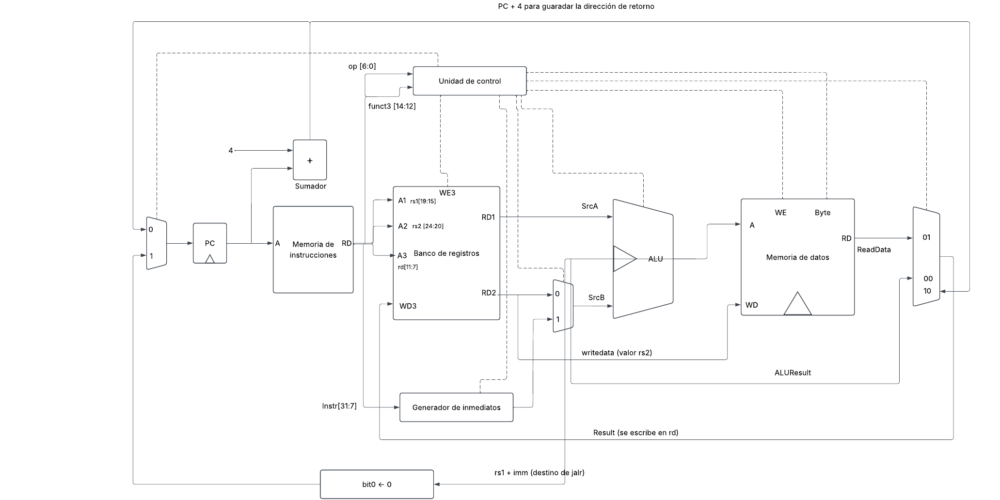
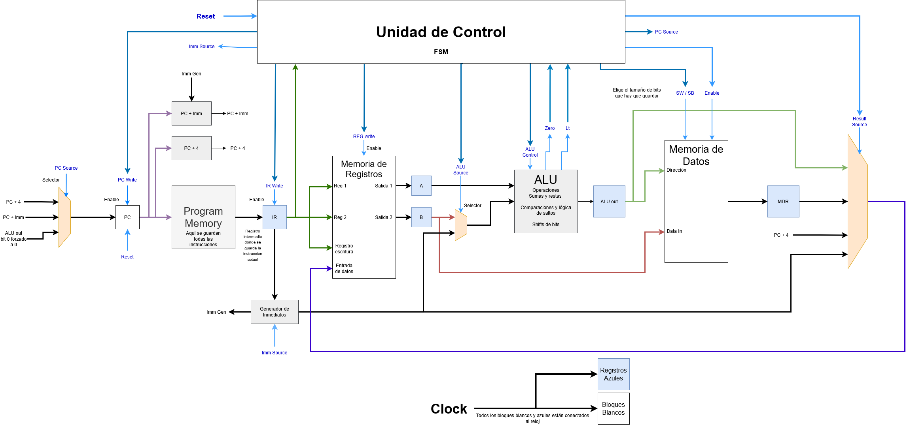

# Diagramas del diseño

Esta carpeta guarda las iteraciones del diagrama de la microarquitectura, en orden. Las versiones
anteriores se conservan para documentar cómo evolucionó el diseño.

## Iteración 1: ruta de datos de un solo ciclo para tipos I y S

Archivo: `iteracion1_uniciclo_tipos_I_S.pdf` (y su versión `.png`)

### Intención

Fue el primer circuito propuesto, preparado para el Avance 1. El objetivo era mostrar una ruta de
datos capaz de ejecutar las instrucciones tipo I y tipo S del programa:

- **Tipo I:** `addi`, `andi`, `slli`, `lw` y `jalr`.
- **Tipo S:** `sw` y `sb`.

El diseño es de un solo ciclo: cada instrucción se completa en un ciclo de reloj. Sus bloques son:

- **PC** con un sumador PC + 4 y un multiplexor de dos entradas para el siguiente PC: PC + 4, o el
  destino de `jalr` (rs1 + imm con el bit 0 en cero, bloque `bit0 ← 0`).
- **Memoria de instrucciones**, cuya salida se separa en campos: opcode y funct3 hacia la unidad de
  control; rs1, rs2 y rd hacia el banco de registros; bits 31:7 hacia el generador de inmediatos.
- **Banco de registros** con dos lecturas (RD1, RD2) y una escritura (WD3, habilitada con WE3).
- **Generador de inmediatos** para los formatos I y S.
- **Multiplexor ALUSrc**, que elige entre rs2 y el inmediato como segundo operando de la ALU.
- **ALU**, que calcula el resultado de `addi`, `andi`, `slli` y las direcciones rs1 + imm.
- **Memoria de datos** con señal de escritura (WE) y selección de byte (Byte) para distinguir
  `sb` de `sw`.
- **Multiplexor de resultado** de tres entradas: ALUResult (00), ReadData (01) y PC + 4 (10, la
  dirección de retorno de `jalr`).
- **Unidad de control** que recibe opcode y funct3 y genera las señales (líneas punteadas).

### Limitaciones identificadas (corregidas en iteraciones posteriores)

- **Es de un solo ciclo.** El diseño final es **multiciclo**: se agregan el IR, los registros A, B,
  ALUOut y MDR, y la unidad de control pasa a ser una máquina de estados.
- **Solo soporta tipos I y S.** Faltaban `bne` y `bge` (tipo B), `lui` (tipo U) y `jal` (tipo J):
  - no hay sumador PC + Imm para el destino de los saltos;
  - la ALU no entrega las banderas Zero y Lt para decidir los branches;
  - el generador de inmediatos no arma los formatos B, U ni J;
  - el multiplexor de resultado no tiene la entrada ImmExt que necesita `lui`;
  - el multiplexor del PC solo tiene dos entradas.
- **Conexiones poco claras.** El cable ALUResult (hacia el multiplexor de resultado) y el destino de
  `jalr` parten de la zona de SrcB y no queda claro que salgan de la salida de la ALU. Además, el
  símbolo de la ALU tiene un triángulo interno que no corresponde.
- **Señales de control sin nombre.** Las líneas punteadas de la unidad de control no indican qué
  señal llevan (RegWrite, ImmSrc, ALUSrc, ALUControl, MemWrite, StoreByte, ResultSrc, PCSrc).

Estas limitaciones se resolvieron en el diseño multiciclo, que usa dos sumadores (PC + 4 y
PC + Imm), un multiplexor de tres entradas para el PC, un multiplexor de resultado de cuatro
entradas y la decisión de los saltos dentro de la unidad de control.

## Iteración 2: ruta de datos multiciclo para todos los tipos de instrucción

Archivo: `iteracion2_multiciclo.png`

### Intención

Es el diagrama del diseño final y el que se implementó en Verilog (`ProyectoRISCV.5`). Corrige las
limitaciones de la iteración 1: el procesador pasa a ser **multiciclo** y ejecuta las 11
instrucciones del programa en sus cinco formatos (I, S, B, U y J). Cada instrucción se reparte en
varios ciclos (Fetch, Decode, Execute, Memory, Writeback) y la unidad de control, una máquina de
estados (FSM), decide qué se hace en cada uno.

### Bloques nuevos o cambiados respecto a la iteración 1

- **Registros intermedios (bloques azules).** El **IR** guarda la instrucción actual; **A** y **B**
  guardan los valores leídos de rs1 y rs2; **ALU out** guarda el resultado de la ALU y **MDR** el dato
  leído de la memoria. Permiten que cada ciclo use lo que calculó el anterior; esto es lo que hace
  multiciclo al diseño.
- **PC con enable (`PC Write`).** El PC solo se actualiza en el último ciclo de cada instrucción.
- **Dos sumadores**, `PC + 4` y `PC + Imm`. El segundo calcula el destino de `bne`, `bge` y `jal`.
- **Multiplexor del PC de tres entradas** (`PC Source`): PC + 4, PC + Imm y ALU out con el bit 0
  forzado a 0 (destino de `jalr`).
- **Generador de inmediatos completo** (`Imm Source`): arma los formatos I, S, B, U y J y extiende el
  signo.
- **ALU con banderas `Zero` y `Lt`** que van a la unidad de control. La **lógica de salto queda dentro
  de la unidad de control**: `bne` salta si `Zero` = 0 y `bge` si `Lt` = 0.
- **Memoria de datos con `SW / SB`**, que elige si se escribe la palabra completa o solo un byte, y
  `Enable` (MemWrite). La dirección viene de ALU out y el dato de B.
- **Multiplexor de resultado de cuatro entradas** (`Result Source`): ALU out (aritméticas), MDR
  (`lw`), PC + 4 (dirección de retorno de `jal` y `jalr`) y el inmediato (`lui`). Su salida vuelve al
  banco de registros (línea morada) como dato de escritura.
- **Señales de control con nombre**: `PC Write`, `IR Write`, `REG write`, `Imm Source`,
  `ALU Source`, `ALU Control`, `SW / SB`, `Enable`, `PC Source` y `Result Source`. La unidad de
  control recibe el opcode y funct3 desde el IR (línea verde) y `Reset`.

### Cómo recorre cada tipo de instrucción

| Tipo | Instrucciones | Camino |
|---|---|---|
| I aritmética | `addi`, `andi`, `slli` | IR → A + inmediato → ALU → ALU out → banco de registros |
| I carga | `lw` | A + inmediato → ALU out (dirección) → memoria de datos → MDR → banco de registros |
| I salto | `jalr` | A + inmediato → ALU out con bit 0 en 0 → PC; PC + 4 → banco de registros |
| S | `sw`, `sb` | A + inmediato → ALU out (dirección); B → Data In; `SW / SB` elige palabra o byte |
| B | `bne`, `bge` | A − B en la ALU → `Zero` / `Lt` → la unidad de control elige PC + Imm o PC + 4 |
| U | `lui` | Inmediato → multiplexor de resultado → banco de registros |
| J | `jal` | PC + Imm → PC; PC + 4 → banco de registros |

### Correspondencia con el Verilog

Cada bloque del diagrama es un módulo o una instancia en `riscv_top.v`: PC e IR (`reg_en`), A, B,
ALU out y MDR (`reg_noen`), sumadores (`sumador`), multiplexores (`mux2`, `mux3`, `mux4`), Program
Memory (`instr_mem`), Memoria de Registros (`regfile`), Generador de Inmediatos (`imm_gen`), ALU
(`alu`), Memoria de Datos (`data_mem`) y Unidad de Control (`control_unit`).

Nota sobre la leyenda del reloj: en la implementación solo los elementos que guardan estado usan el
reloj: los registros azules (PC, IR, A, B, ALU out, MDR), la escritura del banco de registros y de la
memoria de datos, y el registro de estado de la unidad de control. La ALU, los sumadores, los
multiplexores, el generador de inmediatos y las lecturas de las memorias son combinacionales.
