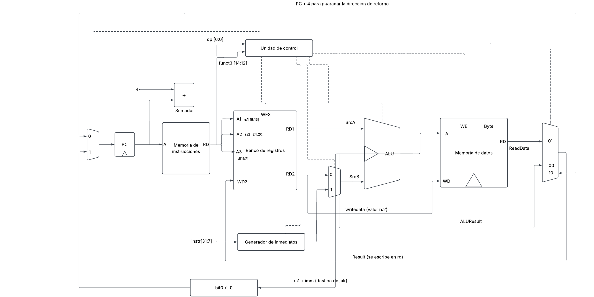

# Diagramas del diseño

Esta carpeta guarda las iteraciones del diagrama de la microarquitectura, en orden. Las versiones
anteriores se conservan para documentar cómo evolucionó el diseño.

## Iteración 1: ruta de datos de un solo ciclo para tipos I y S

Archivo: `iteracion1_uniciclo_tipos_I_S.pdf` (y su versión `.png`)

### Intención

Fue el primer circuito propuesto, preparado para el Avance 1. El objetivo era mostrar una ruta de
datos capaz de ejecutar las instrucciones tipo I y tipo S del programa:

- **Tipo I:** `addi`, `andi`, `slli`, `lw` y `jalr`.
- **Tipo S:** `sw` y `sb`.

El diseño es de un solo ciclo: cada instrucción se completa en un ciclo de reloj. Sus bloques son:

- **PC** con un sumador PC + 4 y un multiplexor de dos entradas para el siguiente PC: PC + 4, o el
  destino de `jalr` (rs1 + imm con el bit 0 en cero, bloque `bit0 ← 0`).
- **Memoria de instrucciones**, cuya salida se separa en campos: opcode y funct3 hacia la unidad de
  control; rs1, rs2 y rd hacia el banco de registros; bits 31:7 hacia el generador de inmediatos.
- **Banco de registros** con dos lecturas (RD1, RD2) y una escritura (WD3, habilitada con WE3).
- **Generador de inmediatos** para los formatos I y S.
- **Multiplexor ALUSrc**, que elige entre rs2 y el inmediato como segundo operando de la ALU.
- **ALU**, que calcula el resultado de `addi`, `andi`, `slli` y las direcciones rs1 + imm.
- **Memoria de datos** con señal de escritura (WE) y selección de byte (Byte) para distinguir
  `sb` de `sw`.
- **Multiplexor de resultado** de tres entradas: ALUResult (00), ReadData (01) y PC + 4 (10, la
  dirección de retorno de `jalr`).
- **Unidad de control** que recibe opcode y funct3 y genera las señales (líneas punteadas).

### Limitaciones identificadas (corregidas en iteraciones posteriores)

- **Es de un solo ciclo.** El diseño final es **multiciclo**: se agregan el IR, los registros A, B,
  ALUOut y MDR, y la unidad de control pasa a ser una máquina de estados.
- **Solo soporta tipos I y S.** Faltaban `bne` y `bge` (tipo B), `lui` (tipo U) y `jal` (tipo J):
  - no hay sumador PC + Imm para el destino de los saltos;
  - la ALU no entrega las banderas Zero y Lt para decidir los branches;
  - el generador de inmediatos no arma los formatos B, U ni J;
  - el multiplexor de resultado no tiene la entrada ImmExt que necesita `lui`;
  - el multiplexor del PC solo tiene dos entradas.
- **Conexiones poco claras.** El cable ALUResult (hacia el multiplexor de resultado) y el destino de
  `jalr` parten de la zona de SrcB y no queda claro que salgan de la salida de la ALU. Además, el
  símbolo de la ALU tiene un triángulo interno que no corresponde.
- **Señales de control sin nombre.** Las líneas punteadas de la unidad de control no indican qué
  señal llevan (RegWrite, ImmSrc, ALUSrc, ALUControl, MemWrite, StoreByte, ResultSrc, PCSrc).

Estas limitaciones se resolvieron en el diseño multiciclo, que usa dos sumadores (PC + 4 y
PC + Imm), un multiplexor de tres entradas para el PC, un multiplexor de resultado de cuatro
entradas y la decisión de los saltos dentro de la unidad de control.
